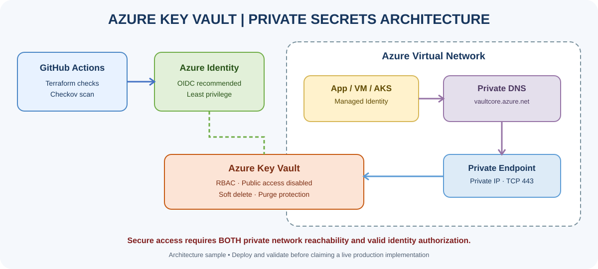
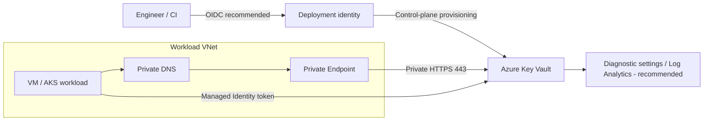

<div align="center">


### Private Link · Microsoft Entra identity · Least-privilege RBAC

[](https://learn.microsoft.com/azure/key-vault/)
[](https://developer.hashicorp.com/terraform)
[](https://learn.microsoft.com/azure/private-link/)

**A Terraform lab for private Azure Key Vault access, identity-based authorization, private DNS and safe secret-management lifecycle controls.**

[Architecture](#-architecture) · [Deploy the lab](#-quick-start) · [Security model](#-security-model) · [Troubleshooting](#-troubleshooting)

</div>

> [!WARNING]
> This repository is a lab template, not proof of deployed or production-validated infrastructure. A private vault is reachable only when network routing/DNS and identity authorization are both correct. Use a non-production subscription and never commit secrets or Terraform state.

## Why private secrets management?

A vault is not secure merely because it stores secrets. Workloads need a private network path, a trusted identity, narrowly scoped permissions, lifecycle safeguards and auditability. This project brings those controls together in a repeatable Terraform example.

## Architecture

<p align="center">
  
</p>

[Open editable diagrams.net source](docs/azure-key-vault-architecture.drawio)



## Security control matrix

| Control | Configuration / intent |
|---|---|
| Authorization | Azure RBAC |
| Workload authentication | Managed Identity |
| Network path | Private Endpoint |
| Name resolution | `privatelink.vaultcore.azure.net` private DNS |
| Public access | Disabled |
| Deletion lifecycle | Soft delete and purge protection |
| Optional workload permission | Key Vault Secrets User, scoped to the workload principal |
| CI checks | Terraform format, validation and Checkov |

Network reachability and authorization are separate gates. A 403 typically indicates an authorization or token issue; a timeout or name-resolution failure points toward networking, DNS or routing. Confirm the actual error and identity before changing permissions.

## Quick start

### Prerequisites

- Terraform CLI 1.6+.
- Azure CLI and access to the intended tenant/subscription.
- Permissions to create a resource group, VNet/subnet, Key Vault, Private Endpoint, private DNS zone/link and (if enabled) role assignment.
- A test client inside the linked VNet for data-plane validation.

### 1. Select the target subscription

```bash
az login
az account list --output table
az account set --subscription "<SUBSCRIPTION_ID>"
az account show --output table
```

### 2. Configure inputs

```bash
cp terraform.tfvars.example terraform.tfvars
```

Edit the local file. The `name_prefix` input is validated; the generated suffix is used to produce a globally unique vault name. Keep the local file out of Git.

### 3. Validate and plan

```bash
terraform fmt -recursive
terraform init
terraform validate
terraform plan
```

Inspect the complete plan and security findings before proceeding.

### 4. Deploy only to a test subscription

```bash
terraform apply
terraform output
```

To create an optional `Key Vault Secrets User` role assignment, set `workload_principal_object_id` to the workload's Microsoft Entra object ID. The deployment identity also needs permission to create role assignments. Leave it empty if authorization is managed separately.

### 5. Verify private access

From a client with a route to the VNet:

1. Resolve `<vault-name>.vault.azure.net`.
2. Confirm the private DNS chain resolves to the private endpoint address.
3. Authenticate as the intended workload identity.
4. Test only the operation granted by RBAC.
5. Verify diagnostic events reach the configured monitoring destination.

Follow [docs/deployment-guide.md](docs/deployment-guide.md) for the full sequence.

### 6. Tear down the lab

```bash
terraform plan -destroy
terraform destroy
```

Private Endpoints may incur charges while provisioned. Purge protection is intentional; deleted-vault recovery and name reuse follow the retention lifecycle.

## Repository map

```text
main.tf / variables.tf / outputs.tf / versions.tf
terraform.tfvars.example
.tflint.hcl
.github/workflows/terraform-checks.yml
docs/
  azure-key-vault-architecture.drawio
  architecture-preview.svg
  deployment-guide.md
  troubleshooting.md
  interview-notes.md
```

## Troubleshooting

| Symptom | First checks |
|---|---|
| DNS returns public address | Private DNS zone, VNet link, record and client resolver |
| Connection timeout | Route, NSG, endpoint approval and private IP reachability |
| HTTP 403 | Token identity, tenant, RBAC role and data-plane scope |
| Terraform role-assignment failure | Deployment principal permissions and object ID |
| Secret works from one subnet only | DNS resolver and route consistency across clients |

Use [docs/troubleshooting.md](docs/troubleshooting.md) before broadening network access or granting wider roles.

## Production-hardening checklist

- [ ] Use OIDC/workload identity federation for automation.
- [ ] Protect remote Terraform state with encryption, locking and least-privilege access.
- [ ] Enable diagnostic settings and alert on relevant vault operations.
- [ ] Define secret rotation, access reviews and ownership.
- [ ] Test DNS and access from every intended workload network.
- [ ] Keep role assignments narrow and review them periodically.
- [ ] Document incident response, recovery and purge-protection procedures.

## CI and evidence

The GitHub Actions workflow runs formatting, backend-free initialization, validation and Checkov scanning. It does not authenticate to Azure or deploy resources. Check [Actions](../../actions) for current run evidence.

## Further reading

- [Deployment guide](docs/deployment-guide.md)
- [Troubleshooting guide](docs/troubleshooting.md)
- [Interview notes](docs/interview-notes.md)
- [Architecture and interview guide](docs/README.md)

## Maintainer

**MD Amirul Haque** · [GitHub](https://github.com/haqueamir70-coder) · [LinkedIn](https://www.linkedin.com/in/md-amirul-haque/)

<sub>Private connectivity is not authorization. Identity is not network reachability. Design both.</sub>
