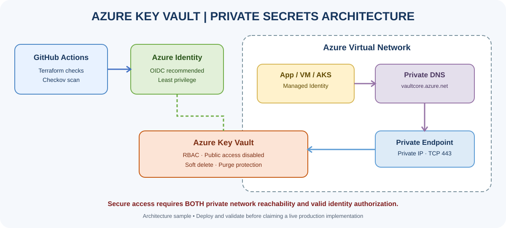
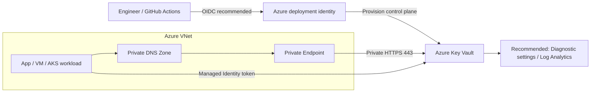

# Azure Key Vault — Private Secrets Management

> Portfolio lab for secure, identity-based secrets access and private networking with Azure and Terraform. **This repository is a lab template; it is not a claim of deployed or production-validated infrastructure.**

  

## Project goals

A secure vault is more than a place to store a password. This hands-on project demonstrates layered identity, network, lifecycle and delivery controls:

- Azure Key Vault using Azure RBAC authorization.
- Private Endpoint and Private DNS zone `privatelink.vaultcore.azure.net`.
- Public network access disabled, soft delete and purge protection.
- Optional `Key Vault Secrets User` assignment for a workload identity.
- Terraform-managed infrastructure and non-sensitive outputs.
- GitHub Actions for formatting, validation and Checkov scanning.
- Troubleshooting guidance for 403 errors, DNS, connectivity and Terraform state safety.

## Architecture



Editable diagram: [Open draw.io source](docs/azure-key-vault-architecture.drawio).



**Key security principle:** network reachability and identity authorization are independent requirements. RBAC alone does not make a privately restricted vault reachable.

## Repository map

```text
.
├── main.tf
├── variables.tf
├── outputs.tf
├── versions.tf
├── terraform.tfvars.example
├── .gitignore
├── .tflint.hcl
├── .github/workflows/terraform-checks.yml
└── docs/
    ├── azure-key-vault-architecture.drawio
    ├── architecture-preview.svg
    ├── deployment-guide.md
    ├── troubleshooting.md
    └── interview-notes.md
```

## Prerequisites

- Terraform CLI 1.6 or later.
- Azure CLI and access to the intended subscription/tenant.
- Permission to create a resource group, VNet/subnet, Key Vault, private endpoint, private DNS zone/link and (if enabled) a role assignment.
- A connected test client (such as a VM inside the VNet) for private data-plane validation.

## Quick start

### 1. Authenticate and select subscription

```bash
az login
az account list --output table
az account set --subscription "<SUBSCRIPTION_ID>"
az account show --output table
```

### 2. Configure variables

Copy `terraform.tfvars.example` to `terraform.tfvars` and edit it. Do not commit the local file. The `name_prefix` validation requires 3–18 characters, starting with a letter and ending in a letter or number, with only letters, numbers and hyphens. The random suffix produces a globally unique vault name.

### 3. Validate and review

```bash
terraform fmt -recursive
terraform init
terraform validate
terraform plan
```

Inspect the plan, cost implications and security scan findings before approving any change.

### 4. Deploy the lab

```bash
terraform apply
terraform output
```

To grant a workload identity `Key Vault Secrets User`, set `workload_principal_object_id` to its Microsoft Entra object ID. The deployment identity also needs permission to create role assignments. Leave it empty to manage authorization separately.

### 5. Validate from a connected network

From a VM or client with a valid network path to the VNet, query `<VAULT_NAME>.vault.azure.net`. The name should resolve through the private-link DNS chain to the private endpoint's private IP. Then authenticate as the intended workload identity and test only the permitted operation. See [deployment guide](docs/deployment-guide.md).

### 6. Tear down carefully

```bash
terraform plan -destroy
terraform destroy
```

Private endpoints can incur charges while provisioned. Purge protection is intentionally enabled; deleted-vault recovery and name reuse are subject to the retention lifecycle. Follow approved recovery procedures rather than bypassing safeguards.

## Security controls and production considerations

| Control | Purpose |
|---|---|
| Azure RBAC | Central identity-based authorization |
| Managed Identity | Avoid embedding workload credentials in code |
| Private Endpoint | Private IP connectivity from a VNet |
| Private DNS | Resolve the normal vault hostname to the private path |
| Public access disabled | Remove public network access to this vault |
| Soft delete and purge protection | Improve recovery and deletion safeguards |
| Least privilege | Keep assigned access limited to required operations |
| CI static scanning | Catch some IaC misconfiguration patterns before deployment |
| Secured remote state | Reduce risk of secret leakage from Terraform state |

Before production use: configure diagnostic settings and alerts; use GitHub OIDC/workload identity federation; secure a remote backend with strict permissions and locking; pin Actions to reviewed immutable SHAs; add branch protections and environment approvals; test DNS and connectivity from actual workload networks; define rotation, access reviews, retention, incident response and recovery procedures.

## CI workflow

The workflow performs Terraform format, initialization without a backend, validation and a Checkov scan. It does not authenticate to Azure or deploy resources. Inspect the **Actions** tab for actual results. A scan is not proof that the full architecture is secure; review findings and validate the runtime design.

## Learning path: basic to advanced

1. Secrets vs keys vs certificates.
2. Microsoft Entra ID, Managed Identity and RBAC.
3. Private Endpoint vs public endpoint and private DNS.
4. Soft delete, purge protection and rotation.
5. Terraform state security and CI/CD OIDC.
6. 403 vs timeout troubleshooting.
7. Audit, alerting, incident response and recovery.

See [deployment guide](docs/deployment-guide.md), [troubleshooting](docs/troubleshooting.md) and [interview notes](docs/interview-notes.md).

## Author

**MD Amirul Haque** · [GitHub](https://github.com/haqueamir70-coder) · [LinkedIn](https://www.linkedin.com/in/md-amirul-haque/)
