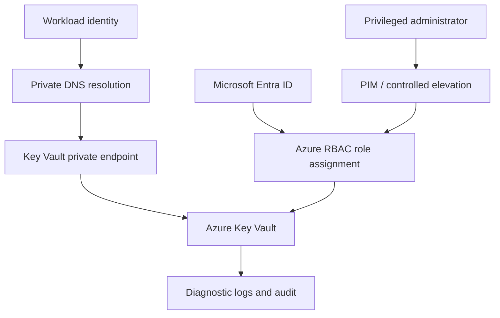

# Azure Key Vault private secrets architecture — Architecture & Interview Guide

Private Key Vault access pattern using identity-based authorization, private endpoint and private DNS. Verify RBAC role scope and name resolution from the consuming subnet.

## Architecture diagram

## Interview questions

1. 1. What is the difference between Key Vault access policies and Azure RBAC?
2. 2. How does a private endpoint change Key Vault connectivity?
3. 3. Why is private DNS required for private endpoint name resolution?
4. 4. How do managed identities remove application secrets?
5. 5. What is the principle of least privilege for Key Vault roles?
6. 6. How do soft delete and purge protection work?
7. 7. How would you rotate a secret without application downtime?
8. 8. How do you audit Key Vault access and failed requests?
9. 9. How do you troubleshoot a private endpoint connection failure?
10. 10. How would you validate that public network access is disabled?

## Interview preparation note
Answer with architecture rationale, security controls, operational failure scenarios, observability and test evidence. Clearly label implemented, CI-validated, deployed and planned scope.

## Interview questions — suggested answers

### 1. Answer

Access policies are vault-specific legacy permissions; Azure RBAC uses the Azure role assignment model with scopes and centralized governance. Prefer RBAC for modern deployments where supported.

### 2. Answer

The private endpoint gives Key Vault a private IP inside the VNet and allows access through private network paths rather than public ingress.

### 3. Answer

Private DNS resolves the standard vault hostname to the private endpoint IP from linked VNets. Without it, clients may resolve public addresses and fail or bypass intended routing.

### 4. Answer

Managed identity gives an Azure workload an Entra identity without storing a client secret. Grant it only the required Key Vault data-plane role.

### 5. Answer

Assign the minimum role at the narrowest scope, such as secrets reader for a workload that only reads secrets. Avoid broad administrator roles for applications.

### 6. Answer

Soft delete retains deleted vaults/objects for a retention period; purge protection prevents permanent deletion during that window. It mitigates accidental or malicious deletion.

### 7. Answer

Create a new version, update consumers to retrieve the current version or use controlled version pinning, verify successful reads, then retire the old secret after overlap.

### 8. Answer

Enable diagnostic settings for audit events, route to protected Log Analytics/Event Hub/Storage, monitor denied access and secret operations, and restrict log access.

### 9. Answer

Check private DNS zone links and A records, endpoint connection state, NSG/UDR routes, firewall rules and identity authorization. Test DNS and TCP from the workload network.

### 10. Answer

Inspect publicNetworkAccess/firewall settings, resolve the vault FQDN from inside and outside the VNet, and verify public requests are denied while private access succeeds.

## Complete zero-to-hero guide

See [ZERO-TO-HERO.md](./ZERO-TO-HERO.md) for the business scenario, architecture walkthrough, tool-by-tool explanations, implementation sequence, practical commands, troubleshooting playbook and additional scenario-based interview questions with answers.
