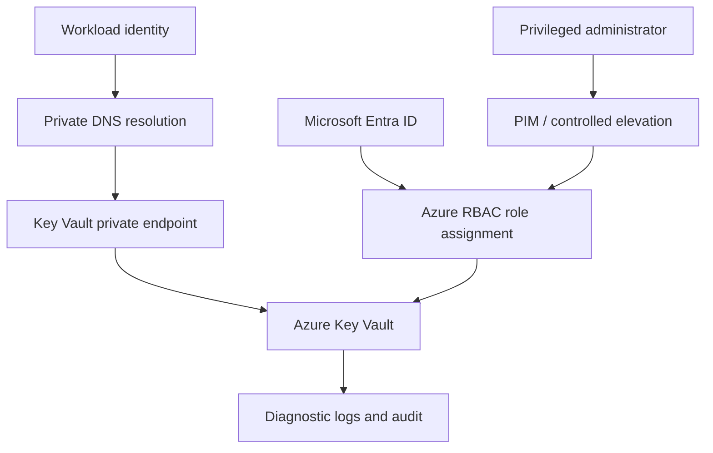

# Azure Key Vault private secrets architecture — Architecture & Interview Guide

Private Key Vault access pattern using identity-based authorization, private endpoint and private DNS. Verify RBAC role scope and name resolution from the consuming subnet.

## Architecture diagram

## Interview questions

1. 1. What is the difference between Key Vault access policies and Azure RBAC?
2. 2. How does a private endpoint change Key Vault connectivity?
3. 3. Why is private DNS required for private endpoint name resolution?
4. 4. How do managed identities remove application secrets?
5. 5. What is the principle of least privilege for Key Vault roles?
6. 6. How do soft delete and purge protection work?
7. 7. How would you rotate a secret without application downtime?
8. 8. How do you audit Key Vault access and failed requests?
9. 9. How do you troubleshoot a private endpoint connection failure?
10. 10. How would you validate that public network access is disabled?

## Interview preparation note
Answer with architecture rationale, security controls, operational failure scenarios, observability and test evidence. Clearly label implemented, CI-validated, deployed and planned scope.
